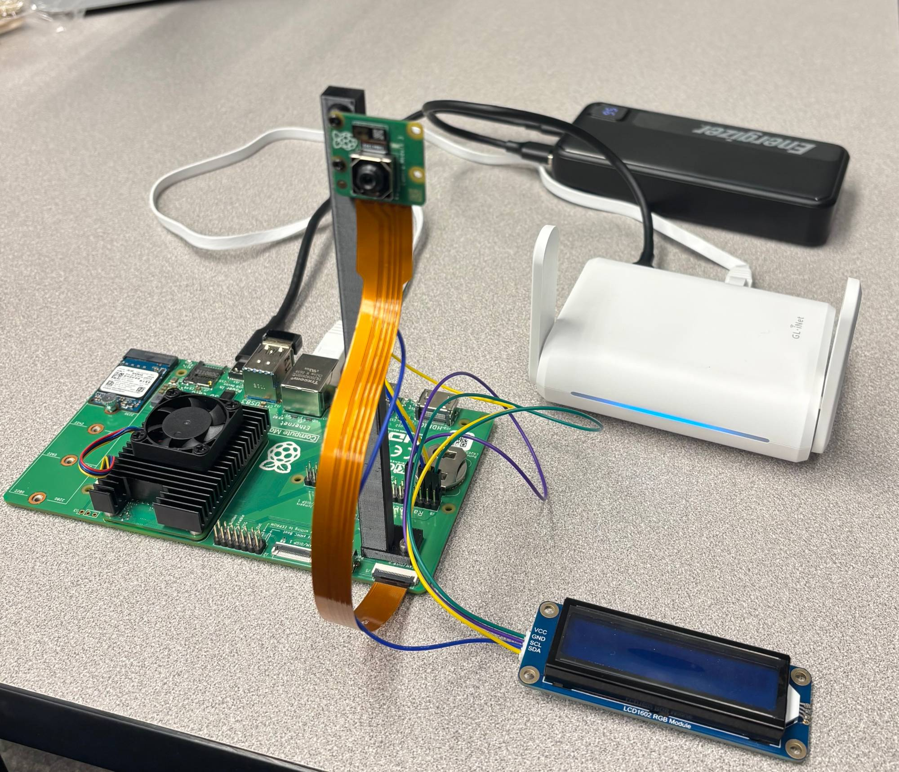
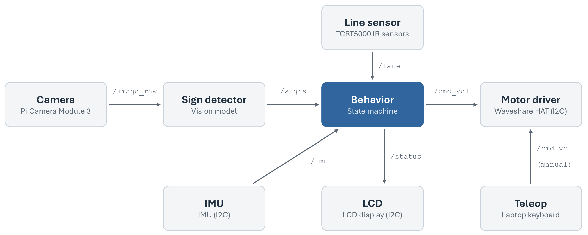
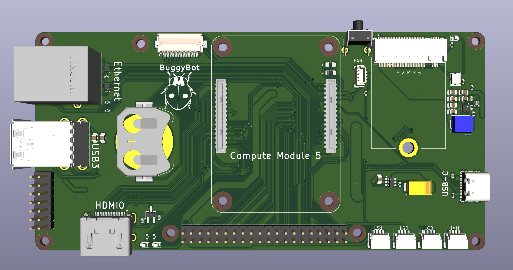
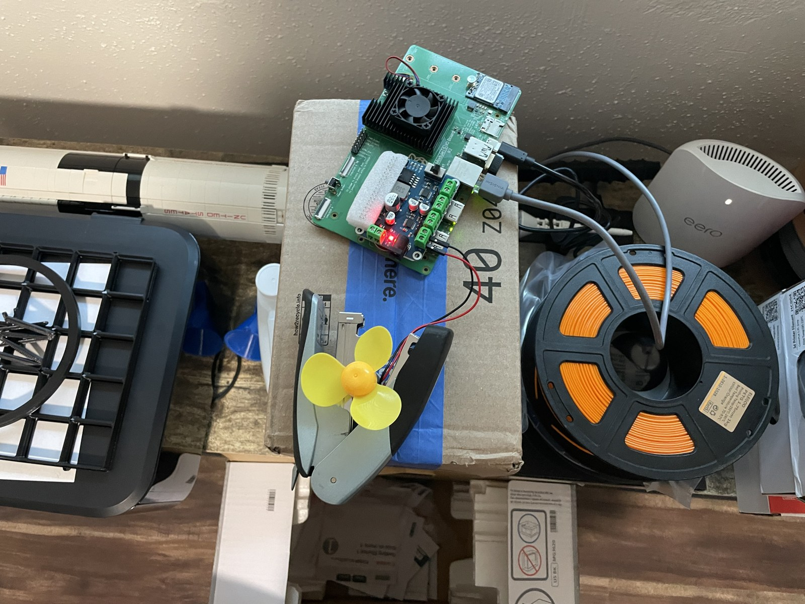
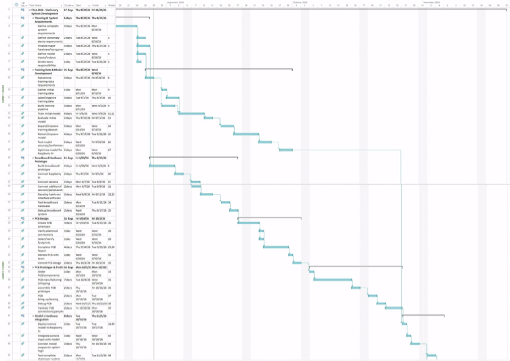

---
**Self Driving RC Car**
Senior Project (CENG 4265) - Semester 1 Project Report

Ethan Wells
Alexis Perez
Ethan Bishop
Abigail Duran

Submitted to Dr. Nguyen
11/19/2026
---

# 1. Abstract

The Self Driving RC Car is a small autonomous vehicle that will follow a controlled course and obey the traffic signs it passes. The project runs for two semesters. This report covers the first semester, whose goal was a stationary sign recognition system that runs entirely on the car's own computer. The system uses a Raspberry Pi Compute Module 5 (CM5), a Camera Module 3, and an LCD. OpenCV finds regions in each camera frame that look like signs, a TensorFlow model that we trained classifies each region, and the LCD shows the result. The model was trained on 9,546 sign images from two public datasets and scored 99.31% on 1,016 held-out test images. In the final live test, 60 of 60 LCD outputs were correct across 10 printed sign classes in two rooms. We also bench-tested the motors, motor controllers, IMU, and line sensors that the vehicle will use, and we completed the design of a custom carrier circuit board. The board was not manufactured because the quote was $583. Nothing drives the vehicle yet. In the second semester we will build the vehicle, follow the course line, and connect sign recognition to motor control.

# 2. Introduction & Background

## Project area

Self-driving vehicles read the road with cameras and act on what they see. One part of that job is traffic sign recognition: finding a sign in the camera image, deciding which sign it is, and responding. Our project builds that capability at a small scale. The finished product is a remote-control-sized car that drives a course on its own, stopping at a stop sign and changing speed for a speed limit sign, while staying on the course line.

The work is split into two phases, one per semester. In the fall we built the recognition system as a stationary unit on a table. In the spring we will mount it on a chassis and add driving. The project title on course deliverables is Self Driving RC Car. Inside the team, the vehicle and its code repository are named BuggyBot.

## Context of the project

Three factors shape the project. The first is economic. The team pays for all hardware, and the proposal set a budget of $500 to $1,000 over two semesters. We have spent $464.25 so far. The second is processing power. A full-size self-driving car carries large computers, but our car must do everything on one small board running on a battery, with no laptop and no cloud service. The third is safety. A vehicle that moves on its own must be able to stop, so the spring design includes an emergency stop and low driving speeds.

## Why the project is worth doing

Traffic sign recognition and self-driving RC cars have both been built before. The purpose of this project is for the team to learn a set of skills that none of us had at the start: training a machine learning model and running it on embedded hardware, designing a printed circuit board (PCB), and making a vehicle sense its surroundings and drive itself. The project is also large enough to give four people real work for two semesters.

## Theory and existing ideas

The sign model is a convolutional neural network (CNN), the standard type of model for classifying images. A CNN learns small visual patterns, such as edges and colors, and combines them into larger ones until it can tell one sign from another. It is trained by showing it thousands of labeled examples. Public datasets supply those examples. The German Traffic Sign Recognition Benchmark (GTSRB) is large and clean, and it is the usual starting point for this problem. For US signs we used the LISA Traffic Sign Dataset from UC San Diego and the Mapillary Traffic Sign Dataset.

A classifier answers only one question: which of the signs it knows does this image look most like? It cannot find a sign in a larger picture, and it cannot say that an image is not a sign at all. A separate detection step is needed before the classifier. We used classical computer vision in OpenCV, which searches each frame for the colors and shapes of signs, to do that job.

# 3. Design

## Project statement

The goal of the project is a self-driving RC car that drives a controlled course from start to finish, stays on the course, and responds correctly to the traffic signs along it. The goal of Semester 1 was a self-contained stationary device that captures an image, recognizes the sign, and shows the result, on its own hardware. The proposal set two success measures for this phase: the device identifies the signs it was trained on at least 90% of the time, and it runs at a few frames per second on the Pi.

Both measures were met for the conditions we tested. The live demo was correct on 60 of 60 outputs, and the sign pipeline ran at 36 frames per second on the CM5 in the 10/28 integration test. Distance, viewing angle, and lighting outside the two test rooms have not been measured.

## Project methodology

- Build the hard part first. The whole project depends on the car reading a sign, so the fall was spent proving recognition on the bench before adding wheels.
- Run hardware and software in parallel. One track trained and deployed the model. The other brought up the electronics and designed the PCB.
- Prove the training method on a clean dataset (GTSRB) before moving to US signs.
- Bring up every part on the stock Raspberry Pi CM5 IO Board, and design the custom carrier board at the same time.
- Test each piece alone, then test everything together.
- Keep code, models, test reports, schematics, and documents in one GitHub repository with automated checks on every push.

## Deliverables

The proposal listed six deliverables for Semester 1. Their status is below.

| Deliverable | Status |
| --- | --- |
| Trained model | Complete. A 12-class US sign model, converted to TensorFlow Lite (621 KB). |
| Camera and image pipeline | Complete. OpenCV captures frames, finds sign regions, and passes crops to the model. |
| On-device recognition | Complete. The model runs on the CM5 with the LiteRT runtime, with no laptop attached. |
| Custom PCB | Designed, not manufactured. PCBWay quoted $583, so the stock CM5 IO Board is used. |
| LCD output | Complete. The LCD shows the sign name, with a backlight color for the sign type. |
| Working stationary unit | Complete. The demo runs from a power bank and is reached over Wi-Fi. |

The sign model is the trained classifier. It takes a 32 by 32 pixel color crop and returns one of 12 US sign classes: added lane, keep right, merge, pedestrian crossing, school, signal ahead, stop, and speed limits 25, 30, 35, 45, and 65.

The camera and image pipeline runs on the CM5. For every 1280 by 720 frame it proposes sign-shaped regions from color and edge masks, classifies each one, and rejects any result whose color or shape cannot belong to the predicted sign. A sign is reported only after three frames in a row agree.

The LCD shows SEARCHING on a green backlight until a sign is confirmed. It then shows the sign name for three seconds on a red, amber, or white backlight that matches the sign.

The custom PCB is a carrier board for the CM5, derived from the Raspberry Pi CM5 IO Board design files. It removes parts the car does not need and adds quick-connect headers for the IMU, the LCD, and two line sensors.

{width=4.2}

## Requirements

- Recognize a set of 10 to 15 common US road signs.
  - Correct on at least 90% of the trained signs.
  - Fast enough to feel real-time, a few frames per second.
- Run on the car's own hardware.
  - No laptop attached and no cloud processing.
  - Powered by a battery so the unit is mobile.
- Show the user what the device sees.
  - The LCD names the recognized sign.
- Do not report things that are not signs.
- Prepare for the vehicle.
  - Bench-test the motors, motor controller, IMU, and course sensors.
  - Confirm the electronics run together without power or communication faults.

## Feature analysis based on user requirements

- Sign names shown to the user
  - I2C LCD with sign name and color-coded backlight
  - Video stream over Wi-Fi for viewing the camera from a laptop
- Correct recognition of US signs
  - Combined LISA and Mapillary training set, 9,546 crops
  - Tested on held-out dataset images and on our own camera photos
- Few false alarms
  - Color and shape checks after the classifier
  - Three matching frames before any output
- Real-time speed
  - Small CNN on 32 by 32 crops, 1.9 ms per crop on the CM5
- Mobile and self-contained
  - 20,000 mAh power bank and a travel router for SSH access
- Ready for driving
  - Two motor controller HATs, IMU, and line sensors tested on the CM5
  - Camera bracket 3D printed to hold the camera above the board

## System architecture & components

- Compute and storage
  - Raspberry Pi Compute Module 5, 4 GB, Lite
  - Raspberry Pi CM5 IO Board
  - 128 GB M.2 NVMe SSD running Raspberry Pi OS Lite
  - Heatsink and fan
- Vision and output
  - Raspberry Pi Camera Module 3
  - Waveshare LCD1602 RGB display (I2C)
- Vehicle sensing
  - Adafruit ICM-20948 IMU (I2C) for heading and turns
  - TCRT5000 infrared line sensors, left and right, for the course line
- Motion
  - Cokoino 4WD Robot HAT (DRV8833) and Waveshare Motor Driver HAT (PCA9685 and TB6612)
  - EMOZNY two-wheel chassis kit with DC gear motors and speed encoders
- Power and networking
  - Energizer 20,000 mAh power bank for the demo
  - Adjustable bench supply, set to 9 V, for motor tests
  - USB Wi-Fi adapter and GL.iNet travel router
- Software
  - Python, TensorFlow and Keras for training, LiteRT for inference on the CM5
  - OpenCV and Picamera2 for the camera pipeline
  - ROS 2 node architecture drafted for Semester 2

The HC-SR04 ultrasonic sensor in the proposal is no longer used. Line sensors fit a marked course better than wall distance, so the team dropped it on 10/27.

{width=6}

# 4. Technical Investigations & Experiments

## Evaluation & selection of tools

- Raspberry Pi Compute Module 5
  - Enough processing power to run the camera pipeline and model in real time.
  - A compute module is made to sit on a custom carrier board, which matched our PCB goal.
- TensorFlow and LiteRT
  - TensorFlow and Keras train the model on a laptop. The model is converted to TensorFlow Lite and run with the small LiteRT runtime, so the CM5 does not need full TensorFlow.
- OpenCV
  - Finds sign regions with color and shape tests. It needs no training data and runs fast on the CM5.
- KiCad
  - Free PCB design software. Raspberry Pi publishes the CM5 IO Board design in KiCad format, which gave us a working starting point.
- Motor controllers
  - Two HATs were bought and tested so the choice can be made on the vehicle. The Cokoino HAT can also power the Pi from a 7 to 12 V battery.
- GitHub and GitHub Actions
  - One repository for all work. Automated checks confirm that scripts compile, re-test the sign pipeline on 329 camera photos, and check motor HAT pin maps and documentation links.

## Development of prototype

**Sign model.** We first trained a CNN on GTSRB to prove the training method. It scored 95.79% on the 12,630 GTSRB test images. This showed that the pipeline works when the data is good. We then trained three models on the same 12 US sign classes: one on LISA (6,097 crops), one on Mapillary (3,449 crops), and one on both combined (9,546 crops). All three use the same network and settings. The network has convolution layers with batch normalization and dropout, followed by a 128-unit dense layer and a 12-way output. Training uses small random rotations, shifts, zooms, and brightness and contrast changes so the model does not memorize exact images, and class weights so rare signs count as much as common ones.

**Sign detection on the CM5.** The first live runs showed the main problem of the semester: false positives. The model has no "not a sign" class, so it gives its best match for anything it is shown. A pink shirt read as a stop sign at 100% confidence. Retraining was not the first step. Instead we added filters around the classifier: a general shape check, tight color ranges, an octagon test for stop signs, a fill limit for diamond signs, a check that rejects fragments of a larger sign, and confirmation over several frames. Each filter was added in response to a measured error, and every LCD output saves its frame and crop so mistakes can be reproduced offline.

**Electronics.** Abigail Duran configured the camera and established I2C communication with the LCD. Ethan Bishop researched, ordered, and tested the IMU and both motor controller HATs and wrote their first test scripts. Alexis Perez researched the ultrasonic sensor, motors, and line sensors and found a faulty motor controller during testing. Ethan Bishop also revised and 3D printed the camera bracket, with a 170 mm upright, after the first design proved too short.

**Custom PCB.** Abigail Duran reviewed the CM5 IO Board schematic, decided which circuits to keep, and redesigned the board. The second HDMI port, the second camera and display connector, and the microSD slot were removed. Headers were added for the IMU, the LCD, and two line sensors. The board has four layers, with routed high-speed differential pairs and power and ground copper zones. The layout and manufacturing files (Gerbers, bill of materials, and pick-and-place) were finished on 11/03.

{width=5.5}

## Testing & debugging

- Sign model on dataset images
  - All three US models were tested on the same 1,016 held-out crops.
  - The combined model scored 99.31%. The LISA model scored 84.94% and the Mapillary model 72.05%.
- Sign model on our own camera
  - 329 photos of our printed sign cards, 10 classes, three lighting conditions.
  - The combined model was correct on all 329. Mapillary scored 79.9% and LISA 47.7%.
  - These crops were placed by hand using the known class, and they come from about 30 distinct setups, so this test is easier than live detection.
- Live sign demo
  - Run 1, first filters: 19 of 24 outputs correct (79%).
  - Run 2, diamond fill limit added: 31 of 36 correct (86%).
  - Run 3, three-frame confirmation: 32 of 32 correct.
  - Final test: 10 sign classes shown 3 times each over two runs in two rooms, 60 of 60 correct.
- Component test (10/28)
  - Seven stages: pin map, I2C scan, line sensors, IMU, motors, sign pipeline, and a 120-second stress run. All passed.
  - The sign pipeline read a card at 98% confidence, with 1.9 ms mean inference at 36 fps.
  - The test found two bugs. The line sensor script was missing a required setting, and the I2C scan missed the LCD because the LCD only answers writes. Both were fixed.
- Stress test (11/02)
  - Motors reversing every second at 60%, camera and model, IMU, line sensors, and LCD all running for 120 seconds, on a 9 V bench supply.
  - The camera held 30.0 fps against a 30.2 fps baseline. There were no under-voltage flags and no I2C or sensor errors. CPU temperature rose from 38.9 to 42.8 °C.
- Power
  - Reading the Cokoino HAT schematic showed that it needs 7 to 12 V. A 5 V supply cannot run the Pi through it, so a bench supply was bought for motor tests.

{width=4.2}

## Usability tests

- Team
  - The team members were the main users. Each run of the live demo was done by holding printed sign cards in front of the camera and grading the LCD output against the saved frames.
  - Alexis Perez tested the model with a webcam on his own computer and on the Pi camera. He observed that glare affected detection and that early versions produced false positives.
- Audience
  - The demo streams the camera view to a browser and shows the confirmed sign as a large colored bar, so the result can be read when projected.
  - The demo was shown to Dr. Nguyen twice during the semester.
  - The team gave the full presentation and live demo to the class The feedback was to measure the distance at which the model can recognize signs, which we have not done yet.

## Results / findings

| Test | Result |
| --- | --- |
| GTSRB model, 12,630 test images | 95.79% |
| Combined US model, 1,016 held-out crops | 99.31% |
| Combined US model, 329 camera photos of sign cards | 100% (329 of 329) |
| Live demo, final test, 10 classes in two rooms | 60 of 60 LCD outputs correct |
| Inference time on the CM5 | 1.9 ms per crop |
| Sign pipeline frame rate on the CM5 | 36 fps |
| 120-second stress test with motors on 9 V | Passed, no errors |

- More varied data mattered more than model design. The same network scored 84.94% with LISA alone and 99.31% with both datasets, and only the combined model held up on our own camera.
- Scores on different test sets cannot be compared. The separate LISA (89.90%) and Mapillary (92.59%) results use different test images, so we re-tested all three models on one shared set.
- A classifier's confidence is not a detection score. The filters around the model are what removed the false positives. They treat the symptom. The real fix is to retrain with a background class and our own camera crops.
- The results have limits. The live thresholds were tuned in one room. Speed limits 30 and 35 were not tested live. Distance and viewing angle were not measured. The combined dataset keeps each source's own split, but we cannot prove that the same physical sign never appears in both training and test images.
- Motors running from a battery, and a loaded drivetrain on the ground, are untested.

# 5. Project Management

## Weekly reports

Each team member had an individual area. Ethan Wells, the group leader, trained the sign models, wrote the live sign demo and the integration tests, and managed the repository and the weekly reports. Alexis Perez researched and tested the motors, ultrasonic sensor, and line sensors, studied OpenCV, tested sign recognition, and designed the project poster. Ethan Bishop handled the IMU and motor controllers, wrote the original sensor test script, did the 3D printing, and started the ROS 2 work. Abigail Duran brought up the camera and LCD and designed the custom PCB.

The team submitted a weekly report and slide deck. Both are built from the repository, and each person edits only their own slide file so that edits never conflict. Hours have been tracked since the third week. The last weekly report was dated 11/3. Counting the week of work after it, the totals are 71 hours for Ethan Wells, 61 for Alexis Perez, 60 for Ethan Bishop, and 60 for Abigail Duran.

Three decisions changed the plan during the semester. First, the LISA dataset named in the proposal was not enough on its own, so we added Mapillary and trained a combined model. Second, the ultrasonic sensor was replaced by line sensors. Third, the custom PCB was not ordered. PCBWay quoted $583 to manufacture and assemble it, which is more than the rest of the project has cost, so the team kept the stock IO Board. The design work still met the learning goal for PCB design.

Spending to date is $464.25, inside the proposal's budget of $500 to $1,000 for the year. The parts in the Semester 1 demo cost $303.09.

| Category | Cost |
| --- | --- |
| Compute and storage | $201.16 |
| Motors and chassis | $62.86 |
| Power | $59.87 |
| Networking | $49.98 |
| Camera and display | $49.94 |
| Sensors and cables | $40.44 |
| Total spent to date | $464.25 |

## Future plans

The goal of Semester 2 is a car that drives a course on its own and obeys the signs.

- Vehicle: a 3D-printed chassis, a final choice between the two motor HATs, and a 7 to 12 V motor battery and charger.
- Driving: follow the course line with the line sensors, use the IMU for heading and turns, and respond to each detected sign.
- Software: connect sign detection to motor control, and evaluate ROS 2 on the CM5. A preliminary ROS 2 version of the sign pipeline runs in Docker on a development machine but has not run on the CM5.
- Sign model: measure the distance at which signs are recognized, as the class feedback asked, and retrain with a background class and BuggyBot camera crops if the filters are not enough once the camera is moving.
- Safety: an emergency stop that can always cut the motors, and low-speed runs on a controlled course.

## Schedule

{width=5.2}

| Proposal milestone | Planned | Actual |
| --- | --- | --- |
| Planning and team responsibilities | Aug 20 | Done in the first week |
| Begin model training and board bring-up | Sep 4 | First model (GTSRB) trained 9/10; CM5 booted on the IO Board by the fifth week |
| Bench prototype and model testing | Sep 30 | Camera, IMU, LCD, and both motor HATs bench-tested by the sixth week; LISA model 9/29, Mapillary and combined models 10/1 |
| Complete PCB design and order | Oct 23 | Design complete 11/03; not ordered |
| Assemble and test PCB | Nov 11 | Not applicable. Integration and stress tests on the stock IO Board passed 10/28 and 11/02 |
| Stationary system demonstration | Nov 20 | Live demo scored 60 of 60 by 10/27; presented to the class in November |

The stationary system was finished ahead of schedule. The PCB design finished about a week and a half late and was then cancelled on cost. Some Semester 2 work started early: the motor controllers, IMU, line sensors, and chassis kit were all bought and bench-tested in the fall, and the integration test already runs every device at once. The largest risks carried into the spring are motor power from a battery and how well sign detection holds up when the camera is moving.
